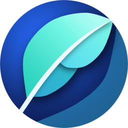

# 🌐 Lite Browser

  

  <b>Chromium Embedded Framework (CEF 154) 순수 Win32 C CAPI 기반의 초경량·초고속 하이브리드 데스크톱 웹 브라우저</b>

  
  
  
  
  
  
  

---

## 📌 왜 Lite Browser인가요? (Why Lite Browser?)

현대의 웹 브라우저는 점점 더 무거워지고 있습니다. **Lite Browser**는 무거운 C++ 런타임 추상화 계층과 프레임워크 오버헤드를 과감히 걷어내고, **순수 C 언어(C11)**로 Chromium의 강력한 엔진(CEF)과 **Windows Win32 Native API**를 직결하여 탄생했습니다.

빠르고 쾌적한 반응성, 극상의 메모리 효율, 그리고 현대적인 **벤토 그리드(Bento Grid) 웹 UI**가 어우러져 **듀얼 화면 분할(Split-View)**, **실시간 탭 분리(Tear-off)**, **내장 고속 PDF 뷰어 및 마크다운(Markdown) 위지웍 에디터**, **지능형 옴니박스 및 스마트 북마크(`lite://favorites`)**, **다운로드 관리자(`lite://downloads`)**, **상시 도킹 AI 에이전트 사이드패널**, **Zero-UAC 무음 자동 업데이트**까지 일상적인 웹 서핑부터 전문적인 멀티태스킹까지 가장 가볍고 강력한 브라우징 경험을 선사합니다.

---

## 🚀 다운로드 및 설치 (Download & Install)

### 공식 설치 파일 다운로드
- **[최신 버전 다운로드 (LiteBrowserInstaller.exe)](https://github.com/gregoryyoon/lite_browser-releases/releases/latest)**
- **지원 환경**: Windows 10 / Windows 11 (64-bit)
- **Zero-UAC 사용자별 설치**: 관리자 권한(UAC) 승인 팝업 없이 `%LOCALAPPDATA%\Programs\LiteBrowser` 경로에 깔끔하게 설치되며, 설치 이후 백그라운드에서 무음 자동 업데이트됩니다.
- **무결성 및 전자 서명**: Authenticode SHA-256 디지털 서명 및 DigiCert RFC 3161 공인 타임스탬프가 적용되어 있습니다.

---

## ✨ 핵심 장점 및 주요 기능 (Key Highlights)

### ⚡ 1. 압도적인 성능과 극상의 효율
- **초경량 네이티브 엔진**: 무거운 C++ 추상화 계층 없이 순수 C11과 Win32 API로 Chromium 엔진을 직접 구동하여 빠른 시동 속도와 즉각적인 반응성을 제공합니다.
- **맞춤형 런타임 성능 모드 (`lite://settings`)**:
  - **실행 속도 우선 (Speed Priority)**: GPU 하드웨어 가속과 Direct3D 래스터화로 최고 성능의 웹 렌더링을 제공합니다.
  - **메모리 절감 우선 (Memory Saver Priority)**: 렌더러 프로세스 및 V8 힙을 최적화하여 저사양 PC나 노트북에서도 RAM 점유율을 30~50% 대폭 절감합니다.

### 🍱 2. 세련된 벤토 그리드(Bento Grid) UI & 완벽한 다크/라이트 테마
- **감각적인 대시보드 디자인**: 설정(`lite://settings`), 북마크(`lite://favorites`), 다운로드(`lite://downloads`) 등 모든 내부 페이지에 심미성과 정보 밀도를 극대화한 **Bento Grid** 카드 UI를 적용했습니다.
- **화이트 플래시(White Flash) 제로**: Win32 네이티브 윈도우 배경 브러시와 DWM 다크 모드를 완벽히 연동하여 창 전환이나 페이지 로딩 시 눈부심이 없는 쾌적한 다크 모드를 제공합니다.

### ◫ 3. 프로페셔널 멀티태스킹: 듀얼 화면 분할 (Dual Split-View) & 자유로운 탭 관리
- **내장 듀얼 화면 분할 (Split-View)**: 별도 확장 프로그램 없이 클릭 한 번으로 단일 탭 내에서 좌/우 2개의 웹페이지를 동시에 비교하고 작업할 수 있습니다 (0.2 ~ 0.8 비율 자유 조절, 분할 즉시 현재 페이지 자동 복제 로드).
- **스마트 탭 매니지먼트**:
  - 탭이 많아져도 자동으로 균등 축소되어 한눈에 파악되는 모던 탭바.
  - 현재 보던 페이지 바로 옆에 새 탭을 열어주는 스마트 상대 위치 삽입.
  - 탭을 창 밖으로 드래그하면 즉시 독립 창으로 분리되고, 다른 창으로 드롭하면 매끄럽게 재결합되는 자유로운 탭 도킹.

### 🤖 4. 상시 대기 독립 도킹 AI 사이드패널 & 보안 볼트
- **작업 흐름을 방해하지 않는 AI 파트너**: 탭을 전환하거나 새 창을 열어도 대화 세션이 끊기지 않는 독립 네이티브 도킹 사이드패널을 제공합니다.
- **Claude & ChatGPT 유료 구독 모델 직접 연동**: 별도 종량제 API Key 발급 없이 기존 **ChatGPT Plus/Pro**, **Claude Pro** 구독 계정 연동과 **Google Gemini**, 로컬 **Ollama** 모델을 모두 지원합니다.
- **실시간 웹페이지 인플레이스 번역**: 해외 웹페이지의 DOM 구조를 보존한 채 자연스러운 한국어로 즉시 번역하고 원문/번역문을 양방향으로 토글합니다.
- **자율 탭 제어 & AI 웹 자동화**: 자연어 명령을 통한 탭 생성/분할/정리, 스마트 본문 및 YouTube 영상 요약, 복합 웹 탐색/입력 자동화를 지원합니다.
- **TOAST UI 마크다운 뷰어 & 에디터 내보내기**: 사이드패널 AI 대화 결과물을 코드 하이라이팅, 수식, 표(테이블)가 완벽 렌더링된 마크다운 문서로 확인하고, 클릭 한 번으로 내장 전체화면 위지웍 에디터(TOAST UI Editor) 새 탭으로 전달하여 이어쓸 수 있습니다.
- **Windows DPAPI 보안 볼트**: 사용자 로그인 세션 토큰 및 API 키를 Windows OS 수준 암호화(`CryptProtectData`)로 로컬에 안전하게 격리 보관합니다.

### 🔍 5. 지능형 옴니박스 & 스마트 북마크 (`lite://favorites`)
- **통합 스마트 검색 카드**: 주소창 입력 시 북마크, 웹 검색, 방문 기록을 한 화면에서 통합 탐색하며 `#태그` 필터링을 지원합니다.
- **방문 빈도 & 최신성 기반 지능형 랭킹**: 최근 30일간 방문 빈도와 최신성을 가중 계산해 자주 찾는 페이지를 최상단에 배치합니다.
- **자동 요약 & 하이라이트 인용구 앵커**: 북마크 시 본문 200자 자동 요약과 핵심 키워드 태그 5개를 생성하며, 드래그한 문장을 앵커로 함께 저장합니다.

### 📥 6. 다운로드 관리자 대시보드 (`lite://downloads`)
- **조용한 백그라운드 다운로드**: 시야를 가리는 팝업 버블 없이 백그라운드에서 신속히 수신하고 상단 툴바 원형 프로그레스 링으로 진행 상태를 안내합니다.
- **중복 방지 & 유니코드 파일 관리**: 동일 파일명 자동 순번 부여(`filename (1).ext`) 및 한글/특수문자 경로 안전 열기를 지원합니다.

### 📄 7. 내장 고속 PDF 뷰어 & 인텔리전트 마크다운 에디터
- **내장 고속 PDF 뷰어**: 별도 뷰어 설치 없이 웹 PDF 및 로컬 `.pdf` 파일을 즉시 열람하고 목차 탐색, 텍스트 검색, 2페이지 보기, 인쇄를 지원합니다.
- **웹 마크다운 렌더링 & 로컬 위지웍(WYSIWYG) 편집**: 웹 `.md` 링크를 깔끔한 문서로 자동 렌더링하며, 로컬 `.md` 파일을 열어 실시간 위지웍 편집·저장(`Ctrl + S`) 및 Mermaid 다이어그램을 오프라인으로 구동합니다.

### 🔄 8. 무음 백그라운드 자동 업데이트 & Windows 10/11 셸 연동
- **방해 없는 무음 업데이트**: 브라우징 중 백그라운드에서 최신 설치 파일을 수신하고 `WinVerifyTrust` 전자 서명을 검증한 뒤, 툴바 알림 뱃지 클릭 한 번으로 즉시 업데이트합니다.
- **원클릭 기본 브라우저 연동**: 설정 화면에서 Windows 기본 브라우저로 간편하게 등록 및 상태를 확인할 수 있습니다.

---

## ⚠️ 알려진 제한 사항 및 호환성 안내 (Known Limitations & Compatibility)

### 🔒 국내 금융·증권사 보안 프로그램 (Kings Online Security 등) 호환성
- **현상**: 한국투자증권 등 일부 국내 금융 및 증권 포털 접속 시 `Kings Online Security 작동 중 오류가 발생했습니다. (ERROR_PROTECTION_FAILED)` 경고창이 발생하며 로그인/거래 페이지 진입이 제한될 수 있습니다.
- **원인**: 금융권 키보드 보안·프로세스 보호 솔루션(Kings Online Security)이 보호 대상 브라우저 실행 파일명을 메이저 브라우저 화이트리스트(`chrome.exe`, `msedge.exe`, `whale.exe` 등)로 제한하기 때문에 `lite_browser.exe`에서 보안 모듈 연동이 차단됩니다.
- **안내**: Lite Browser는 프로세스 위장이나 비인가 DLL 강제 주입 등 보안 안정성을 해치는 우회 처리를 수행하지 않습니다. 해당 보안 프로그램 구동이 필수적인 금융/증권 거래 시에는 **Microsoft Edge** 또는 **Google Chrome**을 이용해 주시기 바랍니다.

---

## 📄 라이선스 및 고지 사항 (License & Notices)

- 본 소프트웨어는 Chromium 및 CEF (Chromium Embedded Framework) 오픈소스 구성 요소를 포함하고 있습니다.
- **Chromium / CEF**: [BSD 3-Clause License](https://opensource.org/licenses/BSD-3-Clause)
- **Lite Browser**: Copyright (C) 2026 Gregory Yoon. All rights reserved.
